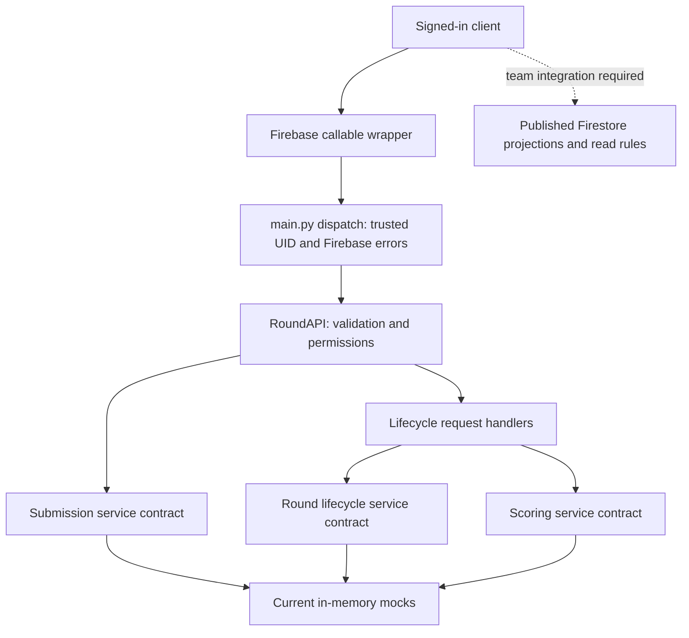

# MadHacks API technical design and review evidence

Review date: **2026-10-27 (America/Chicago)**. Status: API contribution ready for
team review; **real Firebase integration is not verified or implemented here**.
Local verification in `BlottoPlatform`: **250 passing Firebase tests, 0 failed,
0 skipped, including 25 HTTP-style smoke tests and 52 registration tests**.
Python 3.15.1; existing source virtual environment reused without copying it.
This does not establish Firebase deployment runtime compatibility.

## 1. Scope and design authority

This document describes the current source, not a proposed database architecture.
It accompanies [the API guide](../functions/README.md) and the Python contracts in
[round_contracts.py](../functions/game_api/round_contracts.py).

The supplied team-leader high-level MVP requirements establish:

- One allocation per player per competition round, reused against group opponents.
- Initial configuration: 100 soldiers and 10 battlefields, nonnegative integers.
- Replacements allowed while open and strictly before the server-side deadline.
- More battlefield wins wins a match; equal soldiers gives neither player that
  battlefield. Match points: win 1, tie 0.5, loss 0.
- Python callable functions own writes; Firebase Authentication identifies callers;
  Firestore owns storage and rules control frontend reads of published projections.
- Admin lifecycle: `open -> closed -> scored -> published`, with explicit safe
  rescoring before publication.

Engine calculations,
seeded drawing, ranking/tiebreaking, advancement, elimination, leaderboards, and
champion designation remain responsibilities of other team services. Their effects
are **delegated contracts, not implemented algorithms** in this contribution.

The high-level design does not fix every wire field or race policy. Current
implementation choices requiring frontend/team confirmation are listed in section 10.
The preserved team root `README.md` is the high-level design authority.
No agreed Firestore schema is implemented in this contribution.

## 2. Architecture and preserved reference code



| File | Responsibility |
| --- | --- |
| `functions/main.py` | Eleven exported `@https_fn.on_call()` entry points, dispatch and safe error serialization. |
| `functions/game_api/round_api.py` | Round submission/status/inspection, eligibility, strict allocation validation, error mapping, lifecycle routing. |
| `functions/game_api/lifecycle_api.py` | Lifecycle request models, admin check, transition prechecks, explicit safe response projection. |
| `functions/game_api/round_contracts.py` | Typed submission, lifecycle and scoring service interfaces and return objects. Not Firestore schemas. |
| `functions/game_api/round_mocks.py` | Competition eligibility, round allocations, revisions and metadata under an in-process lock. |
| `functions/game_api/lifecycle_mocks.py` | Private seed, frozen snapshot, job statuses/revisions and mock effect counters. No-op team-service hooks. |
| `functions/game_api/runtime.py` | Adapter composition. Currently permits only explicitly configured emulator mocks. |
| `functions/game_api/api.py` | Shared `Actor`, `ApiError`, identifier type; also preserves legacy match-based `GameAPI`, not used by current runtime. |
| `functions/game_api/contracts.py`, `mocks.py` | Historical match-service design retained for reference; `ServiceError` is still shared. |
| `registration_api.py`, `registration_contracts.py`, `registration_mocks.py` (under `functions/game_api/`) | Verified-email registration, allowlist/player service protocols and shared-state local double. |

The legacy FastAPI/SQLite application and its tests were excluded from the transfer.

The real integration will inject submission, lifecycle and scoring adapters into
`RoundAPI` in `runtime.py`. Current runtime requires `FUNCTIONS_EMULATOR=true` and
`GAME_API_BACKEND=mock`, otherwise authenticated requests fail with
`unavailable / services_not_configured`. The handler rejects missing auth before
composition; unavailable composition can precede per-operation validation/role checks.

The emulator fixture is competition `demo`, round `round-1`, with active UIDs
`alice` and `bob`, MVP config, and a deadline one hour after fixture initialization.
The service stores mock seeds; they never appear in callable responses. Mock
state is process-local, disappears on restart, and is not shared between instances.
The mock's `round-{number}` mapping is a fixture convention, not a schema decision.

## 3. Transport and shared request rules

Use the Firebase client SDK's callable protocol, not the old FastAPI routes.
Request object examples below are the callable **data**; raw HTTP wraps it as
`{"data": ...}`. Success is serialized as `{"result": ...}`. Clients normally
read `response.data`. Authentication comes from the callable context, never from
the data object.

| Type/rule | Exact current behavior |
| --- | --- |
| Identifier | Strict string, length 1–128, regex `^[A-Za-z0-9][A-Za-z0-9_.:-]*$`. Applies to competition IDs, round IDs and scoring idempotency keys. |
| Round number | Strict integer >= 1; booleans, floats and numeric strings rejected. No additional maximum is configured. |
| Scoring revision input | Strict integer >= 1 where present. |
| Request object | Strict Pydantic model, unknown fields forbidden. No identity, seed, mode or deadline overrides except the declared `openRound.deadline`. |
| Payload size | At most 65,536 bytes after API-side `json.dumps(..., allow_nan=False).encode("utf-8")`; this is not a raw HTTP byte limit. |
| JSON | Non-JSON/non-finite values and malformed model shapes rejected without echoing input. Firebase may reject malformed envelopes earlier. |
| Deadline input | `openRound` accepts a timezone-aware ISO 8601 string parsed by Python `datetime.fromisoformat`; trailing `Z` is accepted and offsets normalized to UTC. Naive/date-only values rejected. |
| Output timestamps | Service datetimes serialized with `.isoformat()`; null for a missing submission timestamp. |

Services are trusted to return the documented typed projections; dataclasses are
not a substitute for validating raw database records in the real adapters.

## 4. Player and compatibility contracts

### submitAllocation; deprecated alias submit_game

Both accept exactly:

```json
{"competition_id":"demo","round_id":"round-1","allocation":[10,10,10,10,10,10,10,10,10,10]}
```

Both return exactly:

```json
{"competition_id":"demo","round_id":"round-1","game_mode":"colonel-blotto","submitted":true,"revision":1,"saved_at":"2026-10-27T12:00:00+00:00"}
```

Caller must be authenticated, registered and active. The authoritative round must
be `open`, and trusted `now < deadline`. The service supplies
`AllocationConfig(game_mode="colonel-blotto", soldiers=100, battlefields=10,
version="mvp-1")` by default. The API validates the exact configured length and sum.
Each value must be a strict nonnegative integer; zero is allowed, but floats,
booleans, strings, nulls and nested arrays are not. Config is server-owned;
clients cannot choose another mode. Config variation is supported for allocation
validation without implementing another game's rules or a scoring engine.

One logical allocation exists per competition/round/UID. A successful edit replaces
the complete allocation and increments revision; identical repeated calls also
succeed and increment revision. This is not response-level idempotency. Concurrent
valid edits serialize; last committed valid write wins. An invalid/rejected edit
must leave the accepted allocation unchanged. No scoring or awards occur here.

`submit_game` retains its name only: its old match/generic-submission request is
no longer accepted. No match-to-round translation is invented.

### get_submission_status

Input: `{"competition_id":"demo","round_id":"round-1"}`.

Output when absent:

```json
{"competition_id":"demo","round_id":"round-1","submitted":false,"revision":null,"saved_at":null}
```

When present: `submitted=true`, positive integer `revision`, ISO `saved_at`.
Requires registered active caller, including after closure/publication. It returns
only that caller's metadata, never allocations or other players' submission flags.

### admin_inspect_game

Input: `{"competition_id":"demo","round_id":"round-1"}`.

Output:

```json
{"competition_id":"demo","round_id":"round-1","state":"open","deadline":"2026-10-27T13:00:00+00:00","game_mode":"colonel-blotto","submitted_count":2}
```

Requires verified admin claim, not player registration. Metadata only, including
after publication. No allocations, seed, groups or standings are exposed.

### Retained nonoperational compatibility stubs

| Callable | Current result |
| --- | --- |
| `get_game_result` | Requires authentication, then `failed-precondition / direct_reads_required`. No membership lookup or results returned. Frontend reads published projections directly from Firestore. |
| `admin_request_finalization` | Requires authentication and admin, then `failed-precondition / round_lifecycle_deferred`; message directs clients to explicit lifecycle functions. Does not queue anything. |

Stub data is ignored once identity/role checks reach the stub. These are not new
result-read or finalization APIs. With unconfigured runtime, composition may return
`unavailable` first. No original callable name has been deleted.

## 5. Admin lifecycle contracts

All require authenticated admin. Admin claim defaults to exact boolean `admin: true`;
`GAME_API_ADMIN_CLAIM` changes its name in runtime composition. IDs are trusted
service lookups; positive `round_number` is resolved to a `round_id` by that service.

Every lifecycle success returns exactly:

```json
{"competition_id":"demo","round_id":"round-1","round_number":1,"state":"closed","deadline":"2026-10-27T13:00:00+00:00","scoring_revision":1,"scoring_status":"queued"}
```

`state` is `open | closed | scored | published`. `scoring_revision` starts at 0;
`scoring_status` is `not_started | queued | running | failed | completed`.
These are metadata, not engine output. Output projection is explicit, never a
serialization of the entire backend object.

### openRound

Input:

```json
{"competition_id":"demo","round_number":1,"deadline":"2026-10-27T13:00:00Z"}
```

Delegates `open_round(competition_id, round_number, deadline_utc, admin_uid)`.
For a new round, the service checks competition policy and future deadline using
fresh trusted time, and stores open state, config and a random seed together.
The API validates deadline syntax; creation-time validity is enforced in the
service so a retry of an existing identical open remains valid after the deadline.
Existing round/same normalized deadline: return current metadata without reopening
or regenerating seed, even after publication. Different deadline: `round_conflict`.

### closeRound

Input: `{"competition_id":"demo","round_number":1}`.

Reads `lifecycle_status`, checks the open-round deadline, then delegates
`close_round(competition_id, round_number, admin_uid)` for atomic revalidation.
Closing before the deadline is rejected; closing exactly at/after it is allowed.
The round service owns freezing inputs, eliminating non-submitters and seeded
group drawing. No algorithm runs in the API. A repeated close on
closed/scored/published state is a no-op returning current metadata. Failure must
not expose partially completed elimination, groups, or closure.

### scoreRound

Initial request:

```json
{"competition_id":"demo","round_number":1,"idempotency_key":"score-1"}
```

Optional `rescore` defaults to false. `expected_scoring_revision` defaults to null;
omission or explicit null is accepted when `rescore=false`. With `rescore=true`,
a positive expected revision is required; otherwise the request is invalid.

Delegates `request_scoring(competition_id, round_number, idempotency_key, rescore,
expected_scoring_revision, admin_uid)` to `RoundScoringService`. Requires
closed/scored state; open/published requests are rejected. Initial success claims
revision 1 and queues work, leaving the round closed. It does not calculate or
return scores. Worker success commits private results and scored/completed status;
worker failure leaves closed/failed. The current mock only simulates those statuses.

Same key and original arguments: return **current** status without creating another
job (not a historical receipt pinned to the original revision). Same key/different
arguments: `idempotency_conflict`. Another key while queued/running:
`scoring_in_progress`. Another attempt after completion/failure requires rescore.
Keys are scoped to competition/round/scoring operation across admins.

Explicit rescore:

```json
{"competition_id":"demo","round_number":1,"idempotency_key":"rescore-2","rescore":true,"expected_scoring_revision":1}
```

Requires a new key and the current revision after completed/failed work. Requesting
a rescore increments revision, invalidates the previous completed result, and moves
scored back to closed/queued. Stale worker completions must fail. Publication is
blocked until the new revision completes. After publication, even an old scoring
key is rejected rather than starting work. Rescore never publishes or advances.

### publishRound

Input:

```json
{"competition_id":"demo","round_number":1,"expected_scoring_revision":1}
```

Checks scored/completed metadata, then delegates
`publish_round(competition_id, round_number, expected_scoring_revision, admin_uid)`.
The service must recheck current revision and publication permission and guard all
publication/advancement/elimination/leaderboard/champion effects atomically. A
matching retry after publication is a no-op; stale revisions fail. Rescore and
publish must share a guard so only one wins a race. No tournament logic is in the API.

### Transition summary

| Starting state | Operation | Result |
| --- | --- | --- |
| Absent round in valid competition | Open with future deadline | Open, seed stored privately. |
| Open | Submit before deadline | Replace own allocation; remain open. |
| Open | Close at/after deadline | Closed, one frozen snapshot and delegated closure. |
| Closed/unscored | Score | Closed/queued; no public result. |
| Closed/queued or running | Worker succeeds/fails | Scored/completed or closed/failed. |
| Scored/completed or closed/failed | Explicit rescore | Closed/queued at next revision. |
| Scored/completed | Publish current permitted revision | Published; effects applied once. |
| Published | Matching open/close/publish retry | Return current metadata; never revert state. |
| Published | Score/rescore or submit | Reject. |

There are no exported worker callbacks or automatic score/publication triggers.
`complete_scoring_fixture` is test-only mock support, not a production endpoint.

## 6. Authentication, authorization and privacy assumptions

- Firebase's callable wrapper supplies verified `request.auth`; dispatch reads its
  UID/token claims. Payload fields cannot impersonate another user or grant admin.
- Player eligibility is competition-specific. API checks and write-time service
  rechecks are both required. Admins gain no submission eligibility/deadline bypass.
- Exact boolean claim required; `"true"`, `1`, missing/false claims are rejected.
  Current admin privilege is global, not a separately scoped competition role.
- No claim-management endpoint is provided. Trusted assignment, expiration,
  revocation/refresh, disabled-user policy and App Check are team integration work.
- No callable returns allocations, seeds, groups, unpublished standings/results,
  or private engine/database errors. Admin inspection is deliberately restricted too.
- Direct frontend reads must target team-defined published projections. No rules
  or schemas in this folder protect those reads yet. Submitted/scored != published.
- Server/Admin SDK access bypasses client Security Rules; real adapters require
  appropriate IAM and backend checks. Privileged database operators can read data.
- Trusted service projections must be constructed deliberately, not by returning
  raw database records with sensitive fields. Do not log allocations or auth tokens.
- Unknown competition/round uses generic `not_found`. In a known competition the
  mock rejects unregistered/eliminated players before revealing round existence.
  This does not claim full competition-existence concealment or rate limiting.

## 7. Errors and retries

Application errors are `HttpsError(code, safe_message, details={"reason": reason})`.
Firebase clients receive `functions/<code>`. The HTTP transport uses an `error`
object with uppercase status and optional details; success uses `result`.

| Firebase code | HTTP | Stable reasons |
| --- | --- | --- |
| `unauthenticated` | 401 | `authentication_required` |
| `permission-denied` | 403 | `admin_required`, `player_ineligible`, `verified_email_required`, `registration_denied` |
| `invalid-argument` | 400 | `invalid_request`, `invalid_allocation`, `invalid_deadline` |
| `not-found` | 404 | `not_found`, internal dispatch fallback `unknown_operation` |
| `already-exists` | 409 | `round_conflict`, `idempotency_conflict` |
| `failed-precondition` | 400 | `round_not_open`, `deadline_passed`, `configuration_changed`, `direct_reads_required`, `round_lifecycle_deferred`, `deadline_not_reached`, `invalid_transition`, `scoring_incomplete`, `scoring_in_progress`, `rescore_required`, `stale_revision`, `publication_not_permitted` |
| `aborted` | 409 | `conflict` |
| `unavailable` | 503 | `unavailable`, `invalid_configuration`, `services_not_configured` |
| `internal` | 500 | `internal` |

Expected adapter failures must raise `ServiceError` with a mapped reason. Unknown
reasons and unexpected exceptions become generic internal errors; their original
text is suppressed. Validation errors do not echo payloads. Invalid server config
or a naive submission deadline fails safely; validated config must have an integer
nonnegative soldier count, positive integer battlefield count, mode and version.

Missing/invalid tokens, malformed JSON/envelopes and other transport errors may be
rejected by the Firebase SDK before our code and can lack `details.reason`. Clients
must handle this. Retry contention/service failures only after refreshing state;
expired or published rounds cannot be overridden. Retry scoring with the same key
and arguments. Retrying submission is another revision, not a second player entry.

## 8. Required real-data atomicity and failure recovery

These are **adapter requirements**, not verified Firestore guarantees:

| Boundary | Required behavior |
| --- | --- |
| Submission replacement | In one guarded operation read eligibility/state/config/version/deadline, check fresh trusted time on each attempt, validate config consistency/allocation, replace one UID slot and increment revision; return only committed metadata. Conflict with close/config/eligibility writers. |
| Open | Check competition/sequential policy; atomically create state/config/deadline/seed once. Same round/deadline must converge across instances without seed regeneration. |
| Close | Freeze exactly one stable snapshot, coordinate non-submitter elimination and seeded group drawing, then publish completion once with no partial visible effects. Reject new writes using the same state guard. |
| Scoring claim/dispatch | Persist key fingerprint, increment claimed revision, invalidate prior score, and durably dispatch/recover engine work. A failed enqueue cannot leave an unrecoverable queued flag. |
| Worker completion | Check claimed revision/publication fence; atomically store private outputs and success status. Failed jobs retain recoverable failed status. Stale/duplicate completions cannot overwrite newer/published data. |
| Publication | Check completed/current revision and permission; enforce one logical application of all advancement/elimination/leaderboard/champion effects and publish visibility. Serialize against rescoring and concurrent rounds. |
| Privileged auditing | Record trusted admin, operation, scope, key/revision, outcome and trusted time without allocations/tokens/seeds/private results. Mock audit persistence is not implemented. |

For work too large for one Firestore transaction, the team must supply staged,
durable, resumable idempotent steps plus an atomic visibility/completion gate.
Transaction callbacks can rerun: do not perform random drawing, external engine
calls or non-idempotent effects inside callbacks. Stored seeds and frozen snapshots
must survive retries. API prechecks alone cannot close time-of-check/write races.
The precise trusted-time acceptance/commit boundary must be agreed with the data
team; a browser timestamp or time captured before queued retries is insufficient.

Mocks use a shared `RLock`, deep-copied staging, and no-op preparation hooks. Tests
prove these local mechanics, not rollback of real external side effects, durable
queues, process-crash recovery, audit persistence or multi-instance exactly-once effects.

## 9. Verified testing in the team checkout

On 2026-10-27 (America/Chicago), the complete transferred Firebase suite plus
registration tests passed: **250 passed, 0 failed, 0 skipped**. The original local
project's 225 tests included 27 FastAPI tests, leaving 198 transferred Firebase
tests; 52 registration cases bring this contribution to 250. The 25 existing
HTTP-style smoke tests also passed separately. Tests use mocks, not live Firebase.

Commands from the team repository root:

```sh
python -m pip install -r requirements-dev.txt
python -m pytest firebase_tests -q
python -m pytest firebase_tests/test_local_smoke.py -q
python -m pytest firebase_tests/test_registration.py -q
```

Verified dependencies in the existing source virtual environment: Python 3.15.1,
Firebase Functions 0.6.0, Pydantic 2.14.1, Firebase Admin 7.7.0, Flask 3.1.3 and
pytest 9.1.1. `pip check` found no broken requirements. No environment was copied
or installed into the repository; a clean installation and supported deployment
runtime/region remain integration work. The root development requirements include
explicit test imports; production requirements remain in `functions/requirements.txt`.

Coverage includes strict payloads, verified identity/admin claims, configurable
allocations, round eligibility, deadlines and races, privacy, resubmissions,
concurrent lifecycle commands, scoring revisions, stale workers, safe errors,
registration/allowlist failures, duplicate/concurrent joins and shared membership.
HTTP tests exercise actual callable wrappers with controlled token verification;
they do not prove JWT verification, real Auth users, networking, Firestore rules,
transactions, durable dispatch, engine algorithms or multi-instance correctness.

## 10. Unresolved integration dependencies and review decisions

| Owner | Required before real integration |
| --- | --- |
| Firebase/Auth | Project ID, supported Python runtime/region, credentials/IAM, login integration, stable UIDs, trusted global versus competition-scoped admin policy, claim refresh/revocation and optional App Check. |
| Data access | Implement all three protocols; authoritative IDs/config/time, schemas/indexes, transaction/workflow guards, durable snapshots/jobs, audit and recovery. Define real round-number mapping. |
| Game engine | Seeded drawing, group allocation reuse, battlefield/match evaluation, ranking/tiebreaking and idempotent worker completion contract. |
| Publication/tournament services | Publication permission, advancement, eliminations, leaderboard/champion algorithms, exactly-once effects and atomic public projections. |
| Rules/frontend | Deny direct client writes, restrict private data reads, define published read paths and adopt exact callable payloads/revisions/errors. No rules or frontend implemented here. |
| Team leader | Confirm no early close, exclusive submission cutoff, last-committed-edit policy, identical retry revisions, config changes/versioning, positive round numbering, sequential-round policy and status denial after elimination. |
| Integration tests | Real/emulated Auth, Firestore rules/transactions, live callable requests, multiple instances, queued dispatch failure/restart, stale workers and publication privacy. |

The supplied high-level MVP does not specify the exact field casing, extra revision
fields or time-policy details. Existing snake_case payloads and camelCase lifecycle
names are preserved/extended; frontend agreement is still required. No schema,
rules, engine, queue, credential or deploy configuration should be inferred from
these Python dataclasses or mock dictionaries. Current runtime deliberately fails
closed outside explicit emulator mock configuration.

## 11. Player registration contract and flow

`joinCompetition` is an authenticated `@https_fn.on_call()` export. Input:

```json
{"competition_id":"demo","display_name":"Alice"}
```

Minimal success, including retries:

```json
{"competition_id":"demo","registered":true}
```

Dispatch takes UID and claims from `request.auth`. The API requires a nonempty
email from those claims and exact boolean `email_verified: true`, otherwise
`permission-denied / verified_email_required`. Client email, UID, role and other
extra fields are forbidden. Strict display names have 1–80 characters before
trimming, must remain nonblank and contain no Unicode control/format characters.
Names are plain text and must be rendered as text by consumers. Competition IDs
and the serialized 64 KiB payload limit follow the existing player contract.

Flow: callable wrapper -> trusted actor -> registration validation ->
`RegistrationService.authorize(competition_id, uid, email)` -> immutable
`RegistrationGrant` -> `PlayerRegistrationService.ensure_player(grant, display_name)`.
The API verifies the grant matches the requested competition and trusted identity.
Only an explicit safe confirmation is returned; no email/UID/allowlist or player
record is serialized. Unknown adapter failures are sanitized.

The registration service owns allowlist checks, canonical email mapping and
identity policy. The data-access service owns player creation. Creation MUST
atomically recheck allowlist membership, competition policy and email-to-UID
binding; the earlier grant is not sufficient after revocation. One allowlisted
email binds to one UID per competition. Existing-member retries never rename,
reactivate an eliminated member, or reset progress. Concurrent requests must
produce one player. Missing entries/revocations/identity conflicts map to
`permission-denied / registration_denied`; unknown competition to `not-found /
not_found`, contention to `aborted / conflict`, unavailable services to
`unavailable`, unexpected failures to `internal`. Missing adapters produce
`unavailable / services_not_configured`.

`MockRegistrationService` supplies both interfaces under the round mock's lock,
rechecks authorization inside creation and updates the shared membership map.
It uses exact email matching, an in-memory identity binding and no database paths.
Retries preserve active/eliminated state. The emulator fixture allowlists only
`alice@example.test` and `bob@example.test` in `demo`. Those are fixture labels;
real users, allowlist storage, audit, durable identity uniqueness, registration-open
policy and transaction guarantees require the real team adapters.

## 12. MVP interface review and remaining production work

All required exports are present: `joinCompetition`, `submitAllocation`,
`openRound`, `closeRound`, `scoreRound`, `publishRound`. Auxiliary status,
inspection, deprecated submission alias and result/finalization stubs remain;
tests and runtime imports depend on the shared legacy modules. No existing
callable was removed. `mocks.py` is preserved historical reference, not runtime
composition. No old FastAPI routes or SQLite application were transferred.

Differences requiring team agreement: the root design's `admin.*` notation is
implemented as flat camelCase exports guarded by the admin claim; submissions
use opaque `round_id`, lifecycle uses positive `round_number`; requests use
snake_case fields; scoring is queued and revision-fenced; closure is disallowed
before deadline; verified email is required to join; duplicate joins preserve the
original name/state; allocation validation is local rather than an engine import.
These are documented interfaces, not speculative changes to Firestore or engine
ownership. Retain the root README unchanged as the high-level requirements.

Before production, the team must implement and wire real registration, submission,
lifecycle and scoring services; confirm ID/email/admin policy and frontend
payloads; reconcile validation with the engine; supply schema, read projections,
Security Rules/IAM, durable worker recovery and idempotent publication; choose
supported deployment runtime/region; and run real/emulated Auth/Firestore and
multi-instance tests. No live Firebase deployment or data modification occurred.

## 13. Transfer and repository hygiene

The transfer adds only Firebase Python source/contracts/mocks, Firebase tests,
API documentation and development dependencies. The team root README is preserved;
the existing ignore file is extended for database sidecars, environment files,
credential/key patterns and Firebase-generated output. No source `.venv`, database,
cache, credentials, FastAPI application, generated reports or source Git metadata
are copied. Review branch, live remote head, staged names/content and secret
patterns before committing; push only `backend-api` without rewriting history.
